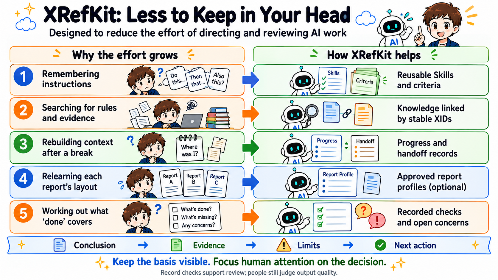

# XRefKit

[](https://pepy.tech/projects/xrefkit)

**Less effort reconstructing AI work. More attention for the decisions that matter.**

XRefKit is designed to reduce the cognitive load of directing and reviewing
AI-assisted work. It keeps reusable procedures, relevant knowledge, progress,
and evidence in explicit records, then helps present results in a form people
can understand and check.



## Why faster AI output can still mean more work for you

Generating a result leaves another task: understanding enough of it to decide
whether to use it. You may have to reconstruct the context, identify claims,
find supporting sources, and check the revised output again. Nielsen Norman
Group describes this verification burden in
[AI Chatbots Discourage Error Checking](https://www.nngroup.com/articles/ai-chatbots-discourage-error-checking/).

XRefKit addresses five recurring sources of that effort:

- **You have to remember what to tell the AI.** Rebuilding instructions from
  memory makes you responsible for recalling every step and criterion.
  **Reusable Skills** keep the procedure, required inputs, expected outputs,
  and criteria available for the next task.
- **You have to search for the rules behind a result.** Scattered reference
  material makes you switch between documents and reconnect them yourself.
  Separate **Knowledge** records and stable identifiers (**XIDs**) let a Skill
  resolve relevant material and record references for review.
- **You have to rebuild context after an interruption.** A conversation history
  leaves you to discover where the work stopped.
  **Work items and handoff records** preserve progress, open concerns, and next
  steps that another session or colleague can pick up.
- **You have to learn how to read each new report.** Changing headings, order,
  or detail makes you search again for the same information.
  **Optional approved report profiles** preserve familiar structure and
  granularity, giving subsequent reviews an explicit baseline.
- **You have to infer what “done” actually covers.** A completion statement can
  leave the checks, evidence, and unresolved decisions unclear.
  **Workflow-record checks and reporting guidance** make those boundaries
  explicit, while tests and reviewers assess the result itself.

The design principle is to make needed information available for recognition,
rather than rely on the reader to recall it—a distinction explained in
[NN/G's recognition and recall guidance](https://www.nngroup.com/articles/recognition-and-recall/).
These mechanisms support that goal; their effect in XRefKit still needs evaluation
with users.

## Make the report easier to understand—and easier to check

A shorter report only helps if it preserves what the reader needs to decide.
XRefKit's reporting guidance connects the conclusion, its basis, its limits,
and the next action within the task's own format:

- **Reduce searching:** put the conclusion and requested decision first.
  Keep material uncertainty beside the claim it qualifies.
- **Reduce mental reconstruction:** connect a finding to its evidence and
  explain why that evidence matters. A file list alone leaves that connection
  for the reader to make.
- **Reduce initial overload:** present the decision-relevant summary, with
  clear links to detailed findings. This applies
  [progressive disclosure](https://www.nngroup.com/articles/progressive-disclosure/)
  to report reading; essential caveats remain in the summary.
- **Reduce relearning:** for recurring outputs, use an approved Knowledge
  quality profile containing examples, headings, table structure, information
  placement, detail, and criteria. Structural checks detect format differences;
  independent review still judges meaning and evidential support.

For illustration, a change-review summary could read:

> **Decision needed:** Hold acceptance until the retry case is checked.
>
> **Verified:** The normal path passed against the agreed criteria; the findings
> link to the test evidence.
>
> **Still unknown:** Whether retrying after a timeout creates a duplicate.
>
> **Next step:** Test the retry case and return the result for review.

This example shows where the reader's attention belongs; it is not a universal
template or a real test result. Plain words, short sections, and explicit
relationships also follow the direction of
[W3C's clear-content guidance](https://www.w3.org/WAI/WCAG2/supplemental/objectives/o3-clear-content/).
That guidance informs presentation, not an accessibility-conformance claim.

Reader feedback can identify a missing explanation, confusing placement, or
insufficient evidence. The correction can then target the output, inputs,
criteria, or procedure. Approved baselines stay intact; procedure changes require
explicit authorization.

The purpose is to make informed review less demanding. A familiar layout or a
passing record check does not establish correctness. See the
[reporting contract](docs/core/contracts/081_skill_reporting_contract.md#xid-6B2D9F4A1C73)
and [fixed-output quality protocol](docs/core/contracts/112_fixed_output_quality_protocol.md#xid-F9C2A8D471B0).

## How does XRefKit fit with modern agent harnesses?

Modern harnesses already support more than execution. Anthropic describes
[durable sessions and execution infrastructure](https://www.anthropic.com/engineering/managed-agents)
as well as [evaluation criteria and structured handoffs](https://www.anthropic.com/engineering/harness-design-long-running-apps).
OpenAI's [harness engineering approach](https://openai.com/index/harness-engineering/)
includes repository knowledge, plans, and automated constraints.

XRefKit's focus is the human effort of directing, understanding, and reviewing
that work. It packages reusable procedures, separately maintained knowledge,
work records, and reporting criteria as assets the team can inspect and maintain.
Repository files and Skill Packages preserve those assets; CLI/MCP interfaces
make them available to compatible clients.

Your coding harness can implement and test a change while XRefKit records the
applicable review method, references, findings, and open concerns. The report
then helps a person decide what the result supports and what to do next.
The client runs the model and tools; XRefKit's `verify` and `close` check
workflow records, while substantive quality needs appropriate tests and review.

If your harness already provides this structure, there may be little to add.
Use XRefKit when you want these work assets and review conventions made explicit
and reusable. This is a difference in packaged mechanisms and emphasis, not a
demonstrated advantage in cognitive load, quality, cost, or performance.

See the [Skill and Knowledge operating model](docs/core/models/052_flow_capability_skill_knowledge_model.md#xid-91C4B7E2D5A8)
and [Skill operating contract](docs/core/contracts/058_skill_operating_contract.md#xid-B7A2C94F0E61).

## Start with one recurring task

Choose a task you already know how to review: a document check, an investigation,
or a development handoff. Start with one procedure and the reference material it
needs, then use the resulting work record to decide what to improve.

### 1. Prepare your workspace

You need Python 3.11 or later. Run these commands in the folder where you want to work:

```powershell
python -m pip install xrefkit
xrefkit init
xrefkit --help
```

Initialization creates the local XRefKit configuration and missing AI startup
files while preserving existing startup files. See the
[installation and Skill Package guide](docs/guides/089_xrefkit_package_first_registration.md#xid-4F8C2A7D1E90)
to add reusable Skills or bring existing material into your workspace.

### 2. Connect your AI tool

For VS Code/Copilot, install the optional MCP integration and generate a setup proposal:

```powershell
python -m pip install "xrefkit[mcp]"
python -m xrefkit mcp setup --repo . --output .xrefkit/setup-review
```

Review the generated files, then apply the setup:

```powershell
python -m xrefkit mcp setup apply --repo . --source .xrefkit/setup-review
```

Open the workspace in VS Code, start the `xrefkit` MCP server, and ask in Copilot chat:

> Call XRefKit's get_startup_context and help me get started.

Then describe the task you want to accomplish. You do not need to know a Skill
name to ask for guidance. Opening VS Code alone does not start the conversation.

For an MCP client that accepts a local server command, the server entry point is:

```powershell
xrefkit mcp serve --repo . --transport stdio
```

### 3. Review the work and decide what comes next

Use the [Skill Run Dashboard](docs/guides/086_skill_run_observation_dashboard_usage.md#xid-4A4763A2DE63)
to inspect recorded progress, referenced knowledge, outputs, concerns, and
handoffs. It shows what was recorded and where observations are missing; you
decide whether the result is ready to use.

The [workflow walkthrough](docs/guides/087_workflow_protocol_sequence_for_humans.md#xid-E8B4D2F19A63)
explains how work moves from a request to verification and handoff.

## Choose your next step

- **Use existing procedures:** [Install and register Skill Packages](docs/guides/089_xrefkit_package_first_registration.md#xid-4F8C2A7D1E90).
- **Organize a task from your own instructions:** [Use an instruction-backed workflow](docs/guides/088_instruction_workflow_protocol.md#xid-9F4C2A7D1B60).
- **Capture your team's way of working:** [Understand Skills and Knowledge](docs/core/models/052_flow_capability_skill_knowledge_model.md#xid-91C4B7E2D5A8), then [author a Skill](docs/guides/013_skill_authoring_with_xref.md#xid-3DB05A0F5F5B).
- **Explore the details:** [Browse the documentation](docs/000_index.md#xid-56DD6EB68343).

## Optional: explore model fit with Attention Pet

The experimental [Attention Pet](projects/attention-pet/README.en.md) companion
helps Codex users inspect estimates of model suitability and compare lower-cost
candidates using the visible work context. Run it from a Codex terminal in this repository:

```powershell
python -m xrefkit.attention_pet serve --port 8769
```

Open the printed address in the Codex browser panel. The preview follows the chat
that launched it. Its estimates are uncalibrated; it does not measure internal
attention or token usage, and it does not change your model settings.

## Contribute or maintain a deployment

For local development, install this checkout with `python -m pip install -e .`.
The [pipeline dependency reference](docs/reference/125_pipeline_dependency_matrix.md#xid-7E4B19C2A860)
describes CI and publication triggers. Internal authoring and runtime details are
in the [SkillDefinition contract](docs/core/contracts/096_skill_definition_contract.md#xid-E6A19D4B72C3)
and [Workflow Runtime Binding contract](docs/core/contracts/111_workflow_runtime_binding.md#xid-8D50A972BA9F).

XRefKit does not require provider API keys to install or explore the package.
Authenticate your AI tool through its provider's supported methods, and keep
secrets and access tokens out of the repository.
