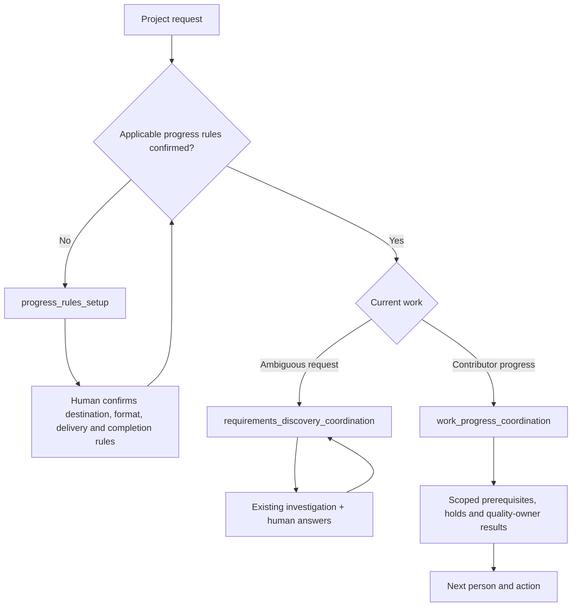

<!-- xid: 78C2A5F1D903 -->

# Project Management

Project Management groups three work-practice Skills for one coordination job.
It does not replace technical investigation, quality verification or human
agreement. The [pack manifest](../../../skills/packs/project-management/pack.md#xid-6A37D1F9B804)
owns the grouping; each Skill remains a public draft with its external governance.

Semantic routing selects the appropriate stage without requiring the user to
name a Skill. Selection is not permission to execute a draft. Always bind the
matching `governance/skills/<skill_id>.json`; missing records must not be used to
obtain an unassessed run. Trial promotion and human adoption remain separate.

The setup stage establishes record destination, format, sharing/attachment
method and completion criteria. Operations cannot substitute Markdown or another
method without confirmation. Within existing authorization, prepare supported
artifacts even when a delivery step is unavailable; distinguish creation, saving,
upload/link, handoff and confirmed shared visibility.

The PyPI distribution candidate is `xrefkit-skills-project-management` version
`0.1.0a1`, package ID `xrefkit.skills.project_management`. It packages the native
definitions, shared persistence reference, bound draft governance and this entry.
Distribution and grouping do not grant maturity. Existing technical and storage
Skills are selected only when available and applicable; absent dependencies are
explicit handoffs, not copied procedures or automatic integrations.

This candidate requires the unreleased Core `0.7.5` support for packaged native
governance. Core `0.7.4` on PyPI cannot supply that guarantee. Build/installation
checks against a local candidate Core do not establish public installability.
See the package README for the release prerequisites and supported entry point.
