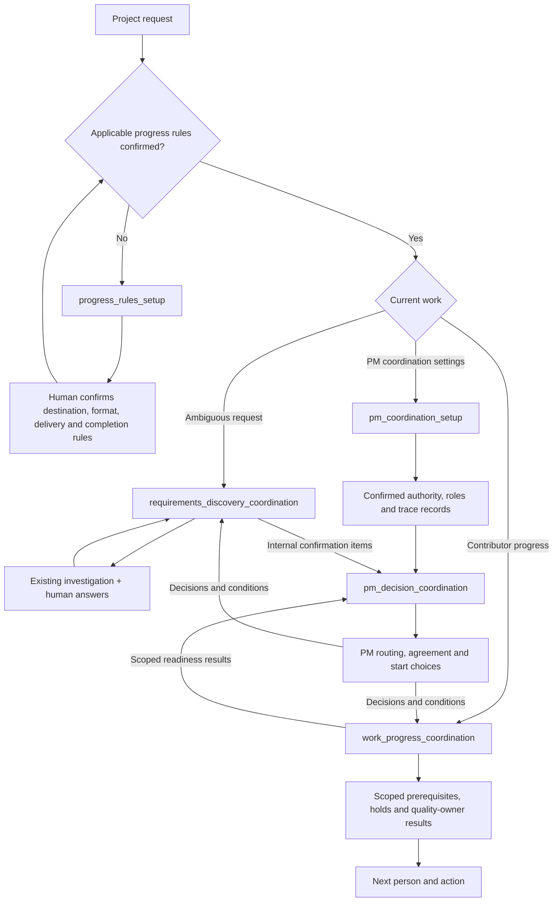

<!-- xid: 78C2A5F1D903 -->

# Project Management

Project Management groups five work-practice Skills for one coordination job.
It does not replace technical investigation, quality verification or human
agreement. The [pack manifest](../../../skills/packs/project-management/pack.md#xid-6A37D1F9B804)
owns the grouping; each Skill is public trial with exact external governance and
an authoring/readiness bootstrap observation, not a claim of actual project use.

Semantic routing selects the appropriate stage without requiring the user to
name a Skill. Selection does not grant project authority. Always bind the
matching `governance/skills/<skill_id>.json`; missing records must not be used to
obtain an unassessed run. Trial promotion and human adoption remain separate.

The base setup stage establishes record destination, format, sharing/attachment
method and completion criteria. Operations cannot substitute Markdown or another
method without confirmation. Within existing authorization, prepare supported
artifacts even when a delivery step is unavailable; distinguish creation, saving,
upload/link, handoff and confirmed shared visibility.

The outer PM loop complements the existing three methods throughout the project.
`pm_coordination_setup` consumes the base setup and adds only decision authority,
stakeholder responsibilities and trace-record settings. Organization rules and
project-specific values remain separately selected Knowledge, not bundled policy.
`pm_decision_coordination` receives existing internal questions, supports the PM's
routing and scoped agreement judgment, and returns decisions and conditions to
internal owners. It tracks answer sufficiency, delivery, reflection and quality
results separately. The existing progress method owns readiness evaluation; the
PM selects which bounded work to start from that result. Neither new method
sends external messages, assigns stakeholders or changes plans automatically.

## Project updates and decisions

The five Skills use the shared
[persistence handoff](../../../skills/packs/project-management/progress_rules_setup/references/persistence_handoff.md#xid-62A9D4E7B103)
for record ownership, updates and review handoffs. Keep the existing project
mapping.

| Record | What the reader can rely on |
| --- | --- |
| Canonical Issue | Current intent, requirements, acceptance criteria, active decisions and approval state, next action and owner. Its current references identify the applicable management and technical records. |
| GitHub Project | Current board status and other configured Project fields. The Issue explains evidenced dependency holds that affect the work. |
| Project Management | Decision and Execution plans, dependencies, schedules and CPM, scoped approval evidence, baselines, revisions and observations. |
| Technical records | Versioned designs, contracts, tests, verification, sources and evidence in existing stores. Include the owner, applicability, and revision, XID or hash when needed for an exact lookup. |
| Original Issue record | The exact prior body for audit and change review, along with GitHub's existing edit history and comments. |
| Human View | A concise display at the top of the Issue. Lead with material changes or the current state, then show actionable decisions, risks, blockers and the next step. |

### Current Issue record and AI handoff

The package module `xrefkit_skills_project_management.issue_work_record`
supports an Issue with one inline managed `IssueWorkRecord` outside the top
Human View. Keep current and archival reference declarations distinct in that
record. `resolve_work_handoff` starts from the current Issue body, resolves the
configured Project and PM locators, and checks the current designated technical
and Decision revisions against the Issue's references. Carry the applicable decisions, execution inputs, unknowns,
authorization scope, verification and stop conditions through the existing
Workflow Runtime Binding. If a required reference is missing, stale, unrelated
or out of scope, stop the affected handoff. Historical snapshots remain
available through their labeled history links.

A host maps existing reads to the input types, checks the destination's access
rules, and supplies exact readbacks and reader-accessible references. Keep its
normalized values bound to the verified bytes. The Issue uses a small inline
record plus links to the project's existing PM and technical stores. The
package does not require a new record store or redefine project approvals,
scheduling history, or Brownfield and Runtime contracts.

### Prepare and deliver an update

1. Save and verify applicable management and technical changes in their
   existing stores. Resolve their exact versions before linking them from the
   current Issue. Prepare the top summary from the current work record, mapped
   Project and applicable sources.
2. Preserve the preceding Issue body and the existing comments and platform
   edit history. Routine updates can use a verified readback from the existing
   Issue history route. Compare prior delivery and managed work-record identity
   before replacing managed
   content, and preserve manual content outside the declared blocks. For a
   legacy migration, require explicit approval for the exact Issue revision,
   verify the complete original's readback, and check the old fragment mapping.
3. Refresh the Issue, Project and required sources before delivery. Use the
   host's guarded writer for automated changes. If a receiving route lacks the
   required guarantee, hand off the prepared candidate for review.
4. Read back the actual destination and sources after a partial or uncertain
   result. `reconcile_current_update` recognizes a confirmed prepared body
   and a verified unchanged prior body or creation reservation. Divergence
   requires a new review. Preserve already verified saves, record any gaps, and retry only
   the unresolved authorized step. A completed source save alone establishes
   no Issue or Project update.

The existing `render_view`, `prepare_create`, `prepare_update` and
`apply_update` routes remain available. `apply_update` requires the guarded
writer's atomic Issue and Project revision comparison. GitHub REST documents
conditional reads and does not document that compare-and-update guarantee for
the Issue body and Project together. Without a host that provides the
guarantee, use the configured review handoff. Test with copied or synthetic
records before seeking production migration approval.

## Distribution

The PyPI distribution is `xrefkit-skills-project-management` version
`0.1.2`, package ID `xrefkit.skills.project_management`. It packages the native
definitions, shared persistence reference, bound trial governance, bootstrap
observation and this entry. The [scheduling interface](scheduling.md#xid-73E20A8D9C51)
adds structured Decision/Execution plans, immutable Gantt history, deterministic
CPM/remaining forecasts and Brownfield impact handoffs.
Distribution and grouping do not grant maturity. Existing technical and storage
Skills are selected only when available and applicable; absent dependencies are
explicit handoffs, not copied procedures or automatic integrations.

This package requires Core `>=0.7.5,<0.8.0` for packaged native governance.
Core `0.7.4` cannot supply that guarantee. Build/installation checks against a
local candidate Core do not establish public installability.
See the package README for the release prerequisites and supported entry point.
