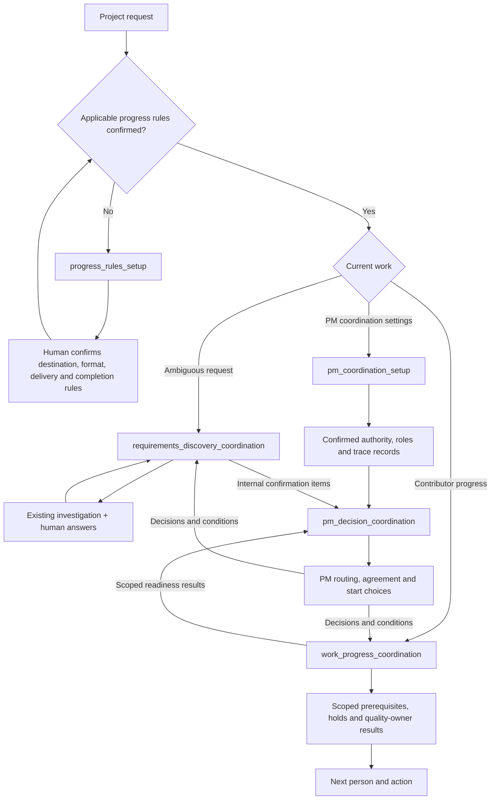

<!-- xid: 78C2A5F1D903 -->

# Project Management

Project Management groups five work-practice Skills for one coordination job.
It does not replace technical investigation, quality verification or human
agreement. The [pack manifest](../../../skills/packs/project-management/pack.md#xid-6A37D1F9B804)
owns the grouping; each Skill is public trial with exact external governance and
an authoring/readiness bootstrap observation, not a claim of actual project use.

Semantic routing selects the appropriate stage without requiring the user to
name a Skill. Selection does not grant project authority. Always bind the
matching `governance/skills/<skill_id>.json`; missing records must not be used to
obtain an unassessed run. Trial promotion and human adoption remain separate.

The base setup stage establishes record destination, format, sharing/attachment
method and completion criteria. Operations cannot substitute Markdown or another
method without confirmation. Within existing authorization, prepare supported
artifacts even when a delivery step is unavailable; distinguish creation, saving,
upload/link, handoff and confirmed shared visibility.

The outer PM loop complements the existing three methods throughout the project.
`pm_coordination_setup` consumes the base setup and adds only decision authority,
stakeholder responsibilities and trace-record settings. Organization rules and
project-specific values remain separately selected Knowledge, not bundled policy.
`pm_decision_coordination` receives existing internal questions, supports the PM's
routing and scoped agreement judgment, and returns decisions and conditions to
internal owners. It tracks answer sufficiency, delivery, reflection and quality
results separately. The existing progress method owns readiness evaluation; the
PM selects which bounded work to start from that result. Neither new method
sends external messages, assigns stakeholders or changes plans automatically.

## Project updates and decisions

The five Skills use the shared
[persistence handoff](../../../skills/packs/project-management/progress_rules_setup/references/persistence_handoff.md#xid-62A9D4E7B103)
to produce a concise Human View from the existing authoritative records.
A progress report leads with material changes from the last identifiable report.
An approval request shows the precise decision, scope of permission, effect of
holding it, and material unresolved risks. Review conclusions distinguish
verified scope from remaining implementation or verification work.

When GitHub is configured, the Project is authoritative for its configured
progress fields. The existing Decision and Execution records own plans,
dependencies, approvals, baselines, revisions and observations. Technical
details use the configured evidence, Knowledge, Brownfield or Runtime record.
The Issue presents the work purpose, acceptance criteria, current decision and
next action with role-labelled references. Use the exact source revisions for
AI handoff and keep them in the underlying records.

### Issue projection candidate

The package module `xrefkit_skills_project_management.issue_projection`
prepares a bounded managed block from frozen source references. A project host
maps its existing reads into the input types, checks the destination's access
rules and supplies exact immutable readbacks and human-readable links. The
module checks identity, revision and content digest before preparing the body.
Keep the host's normalization bound to the verified source bytes. The
projection types are integration inputs and do not change existing stored
records, approval enums, scheduling history or Brownfield formats.

Creation prepares an Issue body from verified sources. For updates preserve
manual content and compare against the latest Issue and Project basis. Before
legacy extraction obtain the per-Issue approval, archive the entire previous
body with exact readback and inventory and preserve incoming fragments. An
existing collapsed technical section requires the same migration checks.

GitHub REST documents conditional reads and its Issue update endpoint does not
document an atomic compare-and-update against Issue, Project and source
revisions together. Use the prepared body in the confirmed review handoff on
GitHub unless the host can supply the required guarded writer. Run the
candidate against copied or synthetic records before seeking a production
migration approval.

The host calls `render_view(current, resolve, previous=previous)` using the
current and last reported source references. `prepare_create(view)` prepares
an initial body for a host-assigned logical identity. `prepare_update`
requires the existing Issue snapshot, the verified archive and, for ordinary
updates, the last delivery's managed block identity. Both return a plan with
no external side effects. `apply_update` accepts a writer with an atomic
Issue and Project compare guarantee. Store the archived snapshot and verified
delivery receipt through the configured provider. Re-read the destination and
source revisions before retrying a conflict or an uncertain outcome.

## Distribution

The PyPI distribution is `xrefkit-skills-project-management` version
`0.1.2`, package ID `xrefkit.skills.project_management`. It packages the native
definitions, shared persistence reference, bound trial governance, bootstrap
observation and this entry. The [scheduling interface](scheduling.md#xid-73E20A8D9C51)
adds structured Decision/Execution plans, immutable Gantt history, deterministic
CPM/remaining forecasts and Brownfield impact handoffs.
Distribution and grouping do not grant maturity. Existing technical and storage
Skills are selected only when available and applicable; absent dependencies are
explicit handoffs, not copied procedures or automatic integrations.

This package requires Core `>=0.7.5,<0.8.0` for packaged native governance.
Core `0.7.4` cannot supply that guarantee. Build/installation checks against a
local candidate Core do not establish public installability.
See the package README for the release prerequisites and supported entry point.
