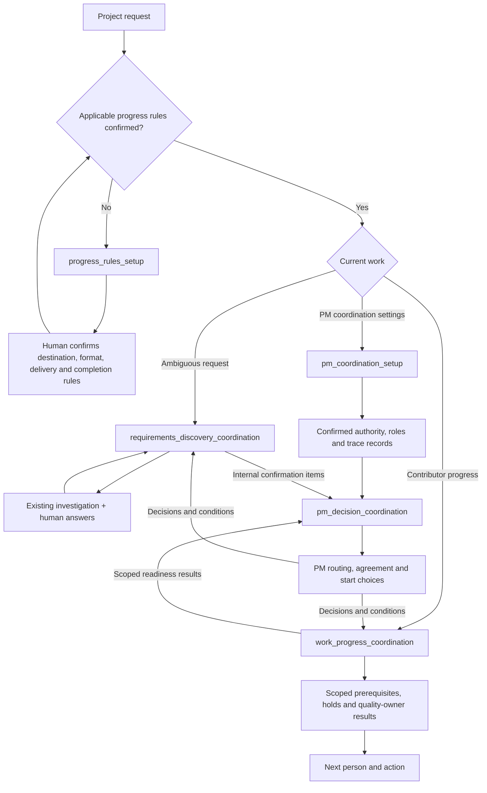

<!-- xid: 78C2A5F1D903 -->

# Project Management

Project Management groups five work-practice Skills for one coordination job.
It does not replace technical investigation, quality verification or human
agreement. The [pack manifest](../../../skills/packs/project-management/pack.md#xid-6A37D1F9B804)
owns the grouping; each Skill remains a public draft with its external governance.

Semantic routing selects the appropriate stage without requiring the user to
name a Skill. Selection is not permission to execute a draft. Always bind the
matching `governance/skills/<skill_id>.json`; missing records must not be used to
obtain an unassessed run. Trial promotion and human adoption remain separate.

The base setup stage establishes record destination, format, sharing/attachment
method and completion criteria. Operations cannot substitute Markdown or another
method without confirmation. Within existing authorization, prepare supported
artifacts even when a delivery step is unavailable; distinguish creation, saving,
upload/link, handoff and confirmed shared visibility.

The outer PM loop complements the existing three methods throughout the project.
`pm_coordination_setup` consumes the base setup and adds only decision authority,
stakeholder responsibilities and trace-record settings. Organization rules and
project-specific values remain separately selected Knowledge, not bundled policy.
`pm_decision_coordination` receives existing internal questions, supports the PM's
routing and scoped agreement judgment, and returns decisions and conditions to
internal owners. It tracks answer sufficiency, delivery, reflection and quality
results separately. The existing progress method owns readiness evaluation; the
PM selects which bounded work to start from that result. Neither new method
sends external messages, assigns stakeholders or changes plans automatically.

The PyPI distribution is `xrefkit-skills-project-management` version
`0.1.0a2`, package ID `xrefkit.skills.project_management`. It packages the native
definitions, shared persistence reference, bound draft governance and this entry.
Distribution and grouping do not grant maturity. Existing technical and storage
Skills are selected only when available and applicable; absent dependencies are
explicit handoffs, not copied procedures or automatic integrations.

This package requires Core `>=0.7.5,<0.8.0` for packaged native governance.
Core `0.7.4` cannot supply that guarantee. Build/installation checks against a
local candidate Core do not establish public installability.
See the package README for the release prerequisites and supported entry point.
