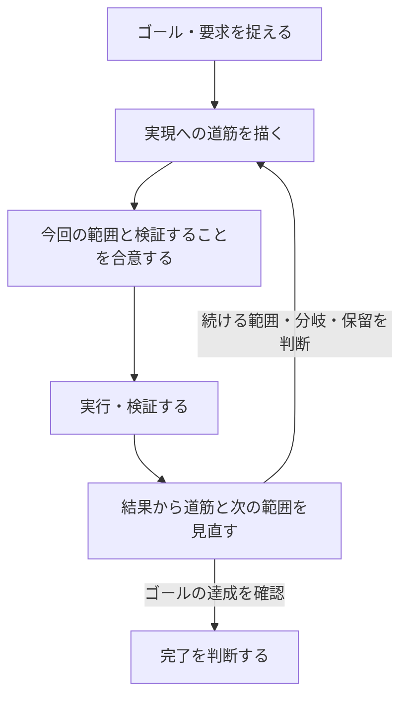
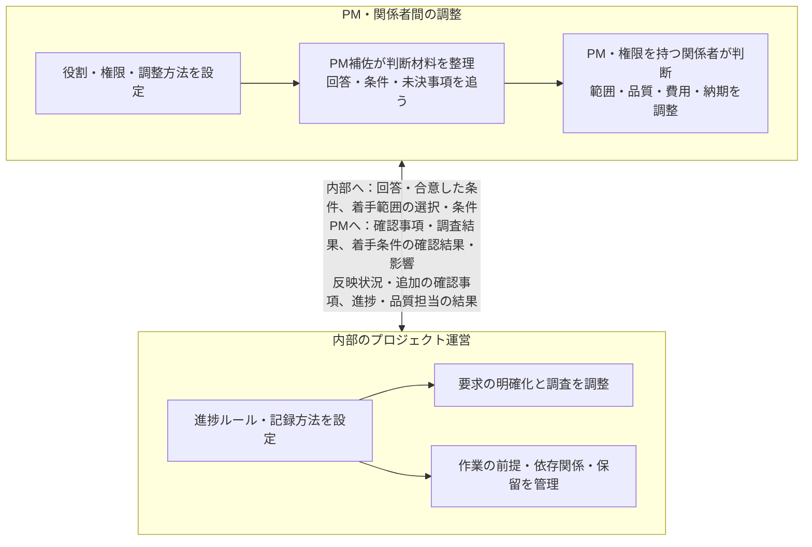
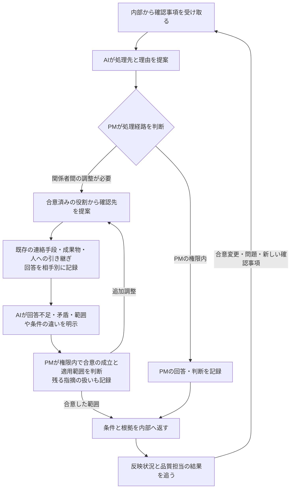
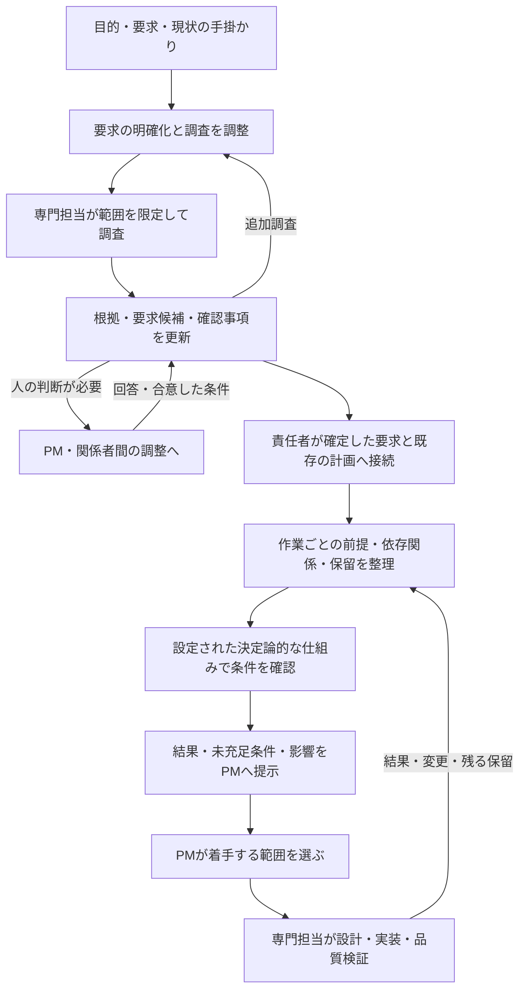

# プロジェクト運営の全体ガイド

このガイドは、ゴール・要求から実現への道筋を描き、今回の範囲を合意し、実行・検証の結果から次を判断する流れを説明します。その流れの中で、Project Management パッケージの五つのスキルが何を支えるかを示します。

参照する公開版は `xrefkit-skills-project-management 0.1.0a2` です。五つとも `draft` であり、公開は実行許可や成熟度の昇格を意味しません。このガイドも新たな実行許可を与えません。

## 1. ゴールへ近づく全体の流れ

ゴールや要求があっても、実現方法のすべてが初めから見えているとは限りません。何を実現し、何を確かめれば次の判断ができるかを整理し、得られた結果を使って道筋を見直します。

この図は目指す進め方の説明であり、実装仕様や自動実行の手順ではありません。道筋や段階の組み立てまで含む一連の支援は検討中の拡張案です。公開済みの五つのスキルだけで、この全体を実装・検証済みという意味ではありません。

関係者の要求を、何を作り、何を確かめればよいか分かる条件に具体化し、実行中の発見を次の合意や判断につなげることが、この構造の目的です。評価したいのは、役割を分けたかだけでなく、発見が必要な判断につながり、その判断が成果物と確認内容に反映されたかです。

## 2. 道筋を描き、今回の範囲と検証を合意する

**この節は検討中の拡張案です。公開済みスキルに、この一連の支援を追加実装したという意味ではありません**。

要求、既存のブラウンフィールド環境、品質・費用・納期などの優先事項から、実現への道筋を検討します。要求が曖昧な場合や実現方法の選択肢が多い場合は、段階的に実現・確認する進め方を検討します。単に機能を何個ずつ作るかではなく、どこまで実現すれば要求の満たし方や業務としての成立を判断できるかで区切ります。全体を一度に実現できる見通しがあれば、その進め方も選べます。

技術側・AIが道筋のたたき台を作り、PM補佐が、PM・関係者が全体と今回の範囲の関係を判断できるよう整理する支援を想定しています。道筋は説明だけで終わらせず、組織・プロジェクトの既存ルールに従う保存先に、後で結果と比較できる記録として残します。特定のファイル名や新しい必須帳票は定めません。

記録には、全体の要求と各段階・今回の範囲の対応、残る範囲、未決部分を示します。今回何を実現・検証し、何が分かったら次のどこへ進むかという判断条件もつなげます。次の段階が結果次第で変わる場合は、一本道に確定せず、条件ごとの分岐や判断待ちの保留を表します。

この道筋をもとに、PM・権限を持つ関係者が、今回実現する範囲と品質・費用・納期・前提、確かめること、その結果から次に判断することを合意します。この活動の主要な成果物の一つが、**スコープ定義**です。全体の要求に対して今回どこまで実現し、何を確かめ、何を次に残すかを明示し、区切った理由・前提・未決事項を結びつけて、後続で生じた変化を判断する基準として残します。結果を受けたら、記録した前提・判断条件と比べ、道筋と次の範囲を見直して再び合意につなげます。

案には、今回の優先事項に照らした選定理由、共通の必須条件と案固有の成立条件、確認済み・未確認の事項を添えます。確認済みの事項は対象範囲・条件・版・結果・根拠を示し、次の確認には判断への影響、確認方法、担当、必要な時期を示します。未確認の事項では、案が置いている仮定も明示します。案数は固定せず、意味のある違いを比較します。

判断に必要な根拠が不足する場合は、調査、技術試験、試作品、目的に合えばMVPを検討します。利用者の反応から学ぶ必要があるかも踏まえて選びます。全案でMVPを作ることや、すべての未確認事項を先に検証することは想定しません。判断を左右する事項に資源を振り向け、既に根拠がある事項はその根拠を使います。

確認したことと、条件を満たすことは同じではありません。満たさないと分かった条件も示し、少量のデータで動いたことを本番相当の負荷でも成立する証拠にはしません。選択に伴うリスクは、前提が成り立たなくなった場合の影響と判断を見直す条件として扱います。裏付けのない発生確率や費用・期間の数値は作りません。

## 3. この流れを支える役割と五つのスキル

システム側のPMは、ステークホルダーとの要求・品質・費用・納期・条件の合意を担い、内部実行側の専門担当は実装と品質確認を担います。この役割分担の骨格自体に新規性があるとは主張しません。

全体の流れのうち、要求を捉え、実行に必要な前提を整理する部分を内部の運営側が支えます。範囲・条件の合意や結果からの判断は、PM補佐が材料を整理し、PM・権限を持つ関係者につなぎます。要求の抜けや制約が判明したら条件調整に戻り、その判断を成果物と確認内容に反映します。この往復はプロジェクト終了まで続きます。

技術的な調査・設計・実装・品質検証は、それぞれの専門担当や既存スキルが実施します。管理スキルがそれらの専門業務や合否判断を代行するわけではありません。

この往復を始める設定として、`progress_rules_setup` は適用する進捗・記録・保存・共有のルールを整え、`pm_coordination_setup` はその基本設定を引き継いで、意思決定の権限、関係者の担当範囲、合意と内部への反映の記録方法を整えます。

「ゴール・要求を捉える」場面では、`requirements_discovery_coordination` が人への確認と専門的な調査をつなぎ、要求候補と根拠を整理します。「今回の範囲を合意する」「結果から見直す」場面では、`pm_decision_coordination` がPMの判断、関係者間の調整、合意の内部への伝達と反映後の追跡を支援します。「実行・検証する」場面では、`work_progress_coordination` が確認済みの前提、依存関係、保留事項、品質担当の結果から次の作業を整理します。道筋そのものの作成支援は、第2節の拡張案として区別します。

組織共通のルールとプロジェクト固有の設定は、適用するKnowledgeや既存のルール管理先から参照します。会議体、保存先、様式、連絡手段はこの共通ガイドで固定しません。

AIが支援する対象は、合意条件と成果物・テストのつながり、既知の確認項目の管理、不足する確認項目の発見、人による次の判断に必要な材料の整理です。AIが確認項目を挙げたことと、必要な品質が実際に検証されたことは区別します。この構造におけるAI支援の実効性は、まだ検証されていません。

## 4. 合意と判断を内部の実行へつなぐ

最初に、PMの権限内で処理できるか、関係者間の調整が必要かをPMが判断します。AIは分類と確認先の候補を根拠付きで示します。関係者の担当範囲が重なる場合や、必要な関係者が見つからない場合も、PMに判断を求めます。

全員が同じ会議へ集まることは前提にしません。個別の回答や少人数の合意には、誰の回答か、どの対象・条件に適用するかを記録します。一人の回答や沈黙を全員の同意とみなしません。

AIの整合性チェックとPMの合意判断は別です。PMが実際の権限内で合意済みと判断した場合、その判断を採用します。指摘が残れば、PMがどう扱ったかも記録します。AIが独自の全員同意条件を追加してPMの判断を拒む設計ではありません。

このスキルには、Slack・Teams・メールなどへの直接送信は含まれません。

## 5. 実行・検証の結果を次の判断へ返す

要求がまだ曖昧でも、答えを求める問いと調査範囲が定まり、担当スキルの前提や権限を満たせば、限定した調査に進めます。要求をすべて確定させてから調査を始める、という順序に限定しません。

前工程全体が完了していなくても、確認済みの一部分を前提に次の作業を検討できます。ただし、条件を確認する仕組みがない場合は、その不足を明示し、確認済みとは扱いません。
着手条件の確認結果と、PMがどこまで着手させるかという選択は別です。AIが自動で着手を承認したり、WBSや計画を書き換えたりするものではありません。

### 合意から検証までの具体例

以下は説明用の架空の例です。実際の業務ルールや確認結果ではありません。

「既存システムに承認経路を追加したい」という要求に対し、専門担当の調査で「承認者が不在のときに誰へ回すか」が確認事項になったとします。

内部の調整担当・専門担当が、対象業務、現行の挙動、未確定の代行条件、影響する要求・作業を整理し、PMが自分の権限で答えられるか、業務側への確認が必要かを判断します。関係者の回答について、PM補佐が対象・条件・根拠と不足を整理し、PM・実際の権限を持つ担当者が今回適用する代行条件と残る指摘の扱いを判断します。

各成果物の担当者は、合意した条件を要求・設計・該当WBS項目へ反映します。品質担当が対象版と検証項目に基づいて検証し、PM補佐が結果と再調整の要否を追跡します。

**回答の受領、回答が十分かの確認、合意の判断、内部への伝達、成果物への反映、品質検証は別々に扱います**。 合意済みでも未反映、反映済みでも検証待ち、という違いが分かるようにします。これらは説明上の区別であり、新たなXRefKitの状態値を定義するものではありません。

リンクが存在するだけでは十分ではありません。合意と設計で対象範囲や条件が同じか、品質結果がその成果物の版を対象としているかも確認します。合意を変更した場合、以前の品質判定をそのまま有効とせず、影響を受ける担当者に再確認を依頼します。

## 6. 正本と更新時の確認先

この日本語ガイドは人向けの説明です。実際の手順、適用条件、停止・引き継ぎ条件は英語の正本を参照します。日本語ガイドはXID管理の対象外です。

- [Project Managementの入口](../../docs/packs/project-management/entry.md#xid-78C2A5F1D903)
- [パックの構成](../../skills/packs/project-management/pack.md#xid-6A37D1F9B804)
- [進捗ルールの設定](../../skills/packs/project-management/progress_rules_setup/SKILL.v1.md#xid-91F7D3B6A204)
- [要求の明確化と調査の調整](../../skills/packs/project-management/requirements_discovery_coordination/SKILL.v1.md#xid-3B8E71A5C902)
- [内部の進捗調整](../../skills/packs/project-management/work_progress_coordination/SKILL.v1.md#xid-A4D902C7E651)
- [PM調整の設定](../../skills/packs/project-management/pm_coordination_setup/SKILL.v1.md#xid-F7B3C9A204D6)
- [PM判断と合意形成の支援](../../skills/packs/project-management/pm_decision_coordination/SKILL.v1.md#xid-C8E4A1D760B3)

文書保守の目安として、正本の責務・入力・出力・引き継ぎが変わったときは、この図の箱と矢印も照合します。拡張案を実装した際は、実際の定義と検証結果を確認してから、現行機能の説明へ移します。図だけを更新して実装済みとは扱いません。
