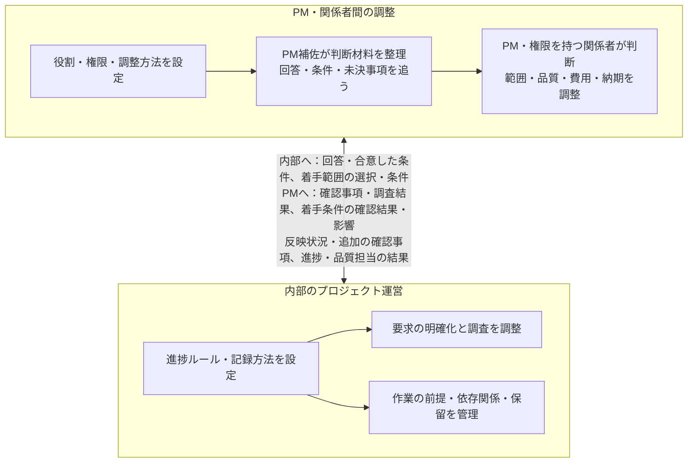
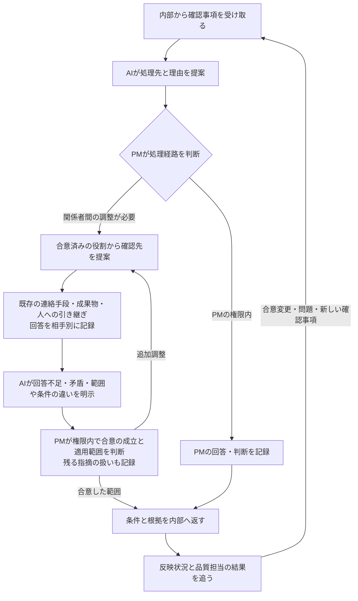
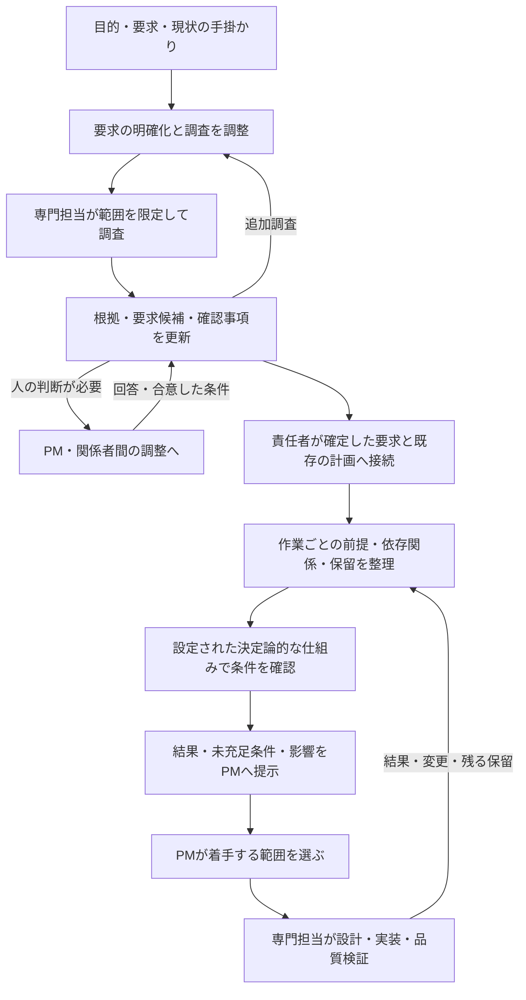
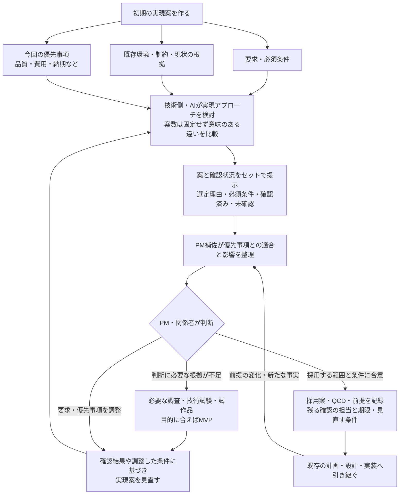

# プロジェクト運営の全体ガイド

このガイドはProject Management パッケージの五つのスキルについて、それぞれの役割と受け渡す情報を説明します。
**PM・関係者間の調整**と**内部のプロジェクト運営**の二つに分けて紹介します。

参照する公開版は `xrefkit-skills-project-management 0.1.0a2` です。五つとも `draft` であり、公開は実行許可や成熟度の昇格を意味しません。このガイドも新たな実行許可を与えません。

## 1. プロジェクト運営を構成する二つのまとまり

プロジェクト運営は、ステークホルダー間で調整する部分と、その調整結果に基づいて内部の作業と成果物の品質を管理する部分の、大きく二つのまとまりで成り立っています。

## 2. PMの判断と内部の作業のつながり

内部の運営側は要求を明確にし、必要な調査を専門担当につなぎ、作業の前提や進捗を整理します。PM補佐はその結果を受けてPMの判断と関係者間の調整を支えます。
合意した内容は内部へ返し、実際に反映されたか、品質担当が何を確認したかまで追います。この往復は要件定義だけで終わらず、プロジェクト終了まで続きます。

技術的な調査・設計・実装・品質検証は、それぞれの専門担当や既存スキルが実施します。管理スキルがそれらの専門業務や合否判断を代行するわけではありません。

## 3. 五つのスキルの役割

| まとまり | スキル | 担当すること |
| --- | --- | --- |
| 内部の運営 | `progress_rules_setup` | 現在適用される既存ルールを確かめ、進捗・記録・保存・共有の設定を整える |
| 内部の運営 | `requirements_discovery_coordination` | 人への確認と専門的な調査を行き来し、要求候補と根拠を整理する |
| 内部の運営 | `work_progress_coordination` | 確認済みの前提、依存関係、保留事項、品質担当の結果から次の作業を整理する |
| PM・関係者調整 | `pm_coordination_setup` | 基本設定を引き継ぎ、意思決定の権限、関係者の担当範囲、合意と内部への反映を記録する方法を設定する |
| PM・関係者調整 | `pm_decision_coordination` | 内部から確認事項を受け取り、PMの判断、関係者間の調整、合意内容の内部への伝達、反映後の追跡を支援する |

組織共通のルールとプロジェクト固有の設定は、適用するKnowledgeや既存のルール管理先から参照します。会議体、保存先、様式、連絡手段はこの共通ガイドで固定しません。

## 4. PM・関係者間の調整

最初に、PMの権限内で処理できるか、関係者間の調整が必要かをPMが判断します。AIは分類と確認先の候補を根拠付きで示します。関係者の担当範囲が重なる場合や、必要な関係者が見つからない場合も、PMに判断を求めます。

全員が同じ会議へ集まることは前提にしません。個別の回答や少人数の合意には、誰の回答か、どの対象・条件に適用するかを記録します。一人の回答や沈黙を全員の同意とみなしません。

AIの整合性チェックとPMの合意判断は別です。PMが実際の権限内で合意済みと判断した場合、その判断を採用します。指摘が残れば、PMがどう扱ったかも記録します。AIが独自の全員同意条件を追加してPMの判断を拒む設計ではありません。

このスキルには、Slack・Teams・メールなどへの直接送信は含まれません。

## 5. 内部のプロジェクト運営

要求がまだ曖昧でも、答えを求める問いと調査範囲が定まり、担当スキルの前提や権限を満たせば、限定した調査に進めます。要求をすべて確定させてから調査を始める、という順序に限定しません。

前工程全体が完了していなくても、確認済みの一部分を前提に次の作業を検討できます。ただし、条件を確認する仕組みがない場合は、その不足を明示し、確認済みとは扱いません。
着手条件の確認結果と、PMがどこまで着手させるかという選択は別です。AIが自動で着手を承認したり、WBSや計画を書き換えたりするものではありません。

## 6. 一往復の具体例

以下は説明用の架空の例です。実際の業務ルールや確認結果ではありません。

「既存システムに承認経路を追加したい」という要求に対し、専門担当の調査で「承認者が不在のときに誰へ回すか」が確認事項になったとします。

| 段階 | 受け渡す内容 | 判断・実施の担当 |
| --- | --- | --- |
| 内部からの確認 | 対象業務、現行の挙動、未確定の代行条件、影響する要求・作業 | 内部の調整担当・専門担当 |
| 処理先の判断 | PMの権限で答えられるか、業務側の確認が必要か | PM |
| 関係者の回答 | 業務側の回答と、その対象・条件・根拠。回答の足りない部分 | 関係者が回答し、PM補佐が整理 |
| 合意判断 | 今回適用する代行条件と、残る指摘の扱い | PM・実際の権限を持つ担当者 |
| 内部への伝達と反映 | 合意した条件を要求・設計・該当WBS項目につなぐ | 各成果物の担当者 |
| 品質確認と追跡 | 検証項目と対象版、品質担当の結果、再調整の要否 | 品質担当が検証し、PM補佐が結果を追跡 |

**回答の受領、回答が十分かの確認、合意の判断、内部への伝達、成果物への反映、品質検証は別々に扱います**。 合意済みでも未反映、反映済みでも検証待ち、という違いが分かるようにします。これらは説明上の区別であり、新たなXRefKitの状態値を定義するものではありません。

リンクが存在するだけでは十分ではありません。合意と設計で対象範囲や条件が同じか、品質結果がその成果物の版を対象としているかも確認します。合意を変更した場合、以前の品質判定をそのまま有効とせず、影響を受ける担当者に再確認を依頼します。

## 7. 初期の実現案とQCDの合意に関する拡張案

**この節は今回の会話で整理した検討中の拡張案です。公開済みスキルに、この一連の手順を追加実装したという意味ではありません**。

初期の合意形成では、何をどこまで、どの品質・費用・納期で実現するかを判断するたたき台が必要です。要求、既存のブラウンフィールド環境、その時点の優先事項から実現アプローチを検討し、案と確認状況を一緒に提示する流れを想定しています。

| 案に添える項目 | 明らかにすること |
| --- | --- |
| 選定理由 | 今回の優先事項にどう適合するか。何を優先し、どんな制約が残るか |
| 必須条件 | すべての案に共通する要求条件と、その案を採るための固有の成立条件 |
| 確認済み | 何を、どの範囲・条件・版で確認したか。その結果と根拠 |
| 未確認 | まだ確認していない事項と、案が置いている仮定 |
| 次の確認 | 採用・着手の判断への影響、確認方法、担当、必要な時期 |

確認したことと、条件を満たすことは同じではありません。確認の結果、満たさないと分かった条件も示します。少量のデータで動いたことを本番相当の負荷でも成立する証拠にはしません。

MVPを全案で作ることや、すべての未確認事項を先に検証することは想定していません。判断を左右する事項に資源を振り向け、調査や小さな試験で足りるか、利用者の反応から学ぶためのMVPが必要かを選びます。既に根拠がある事項はその根拠を使います。

この整理では、技術側が案と確認事項を用意し、PM補佐は同じ案や確認事項を重ねて作らず、関係者の判断につなぎます。選択に伴うリスクも前提が成り立たなくなった場合の影響と、判断を見直す条件として合意形成の中で扱います。発生確率や費用・期間の裏付けがなければ、数値を作って埋めません。

## 8. 正本と更新時の確認先

この日本語ガイドは人向けの説明です。実際の手順、適用条件、停止・引き継ぎ条件は英語の正本を参照します。日本語ガイドはXID管理の対象外です。

- [Project Managementの入口](../../docs/packs/project-management/entry.md#xid-78C2A5F1D903)
- [パックの構成](../../skills/packs/project-management/pack.md#xid-6A37D1F9B804)
- [進捗ルールの設定](../../skills/packs/project-management/progress_rules_setup/SKILL.v1.md#xid-91F7D3B6A204)
- [要求の明確化と調査の調整](../../skills/packs/project-management/requirements_discovery_coordination/SKILL.v1.md#xid-3B8E71A5C902)
- [内部の進捗調整](../../skills/packs/project-management/work_progress_coordination/SKILL.v1.md#xid-A4D902C7E651)
- [PM調整の設定](../../skills/packs/project-management/pm_coordination_setup/SKILL.v1.md#xid-F7B3C9A204D6)
- [PM判断と合意形成の支援](../../skills/packs/project-management/pm_decision_coordination/SKILL.v1.md#xid-C8E4A1D760B3)

文書保守の目安として、正本の責務・入力・出力・引き継ぎが変わったときは、この図の箱と矢印も照合します。拡張案を実装した際は、実際の定義と検証結果を確認してから、現行機能の説明へ移します。図だけを更新して実装済みとは扱いません。
